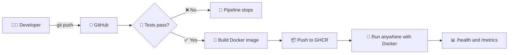

<div align="center">

# 🎓 Student Management App
### ⚙️ A tiny app with a *fully automated* DevOps pipeline 🚀

*Push code → GitHub tests it → Docker packs it → it's ready to run anywhere.*

[](https://github.com/gosavidevashish/Internship-Projects/actions/workflows/ci-cd.yml)


<br>

**🧰 Built with**


</div>

---

## 🧭 Quick Navigation

| | | |
|---|---|---|
| [✨ Features](#-features) | [🏗️ How it works](#️-how-it-works) | [🚀 Quick start](#-quick-start) |
| [🐳 Docker](#-run-with-docker) | [🔁 CI/CD pipeline](#-cicd-pipeline) | [📡 API](#-api-reference) |
| [📊 Monitoring](#-monitoring) | [🎬 Demo guide](#-demo-guide) | [🔮 Roadmap](#-roadmap) |

---

## 💡 What is this?

A lightweight **Student Management** web app built to show a complete, automated **DevOps workflow**. The app is intentionally simple, because the real star is the **automation around it**.

```text
👨‍💻 Code  ➜  🐙 GitHub  ➜  🧪 Test  ➜  🐳 Docker  ➜  ⚙️ CI/CD  ➜  📊 Monitor
```

### 🎯 At a glance

| 🏷️ Item | 📋 Details |
|---|---|
| **App type** | Student Management web app (add, list, delete) |
| **Pipeline** | GitHub Actions: test, build image, push to registry |
| **Container registry** | GitHub Container Registry (GHCR) |
| **Monitoring** | `/health` and `/metrics` endpoints |
| **Dependencies** | None (pure Node.js) |

---

## ✨ Features

- 🎓 **Manage students**: add, view and delete from a clean web page
- 🧪 **Automated tests**: 5 tests run on every push
- 🐳 **Dockerized**: runs the same way on any machine
- 🤖 **Fully automated pipeline**: no manual build steps
- ❤️ **Health check**: instantly know if the app is alive
- 📈 **Metrics**: requests, errors, memory and uptime
- 🪶 **Zero dependencies**: nothing to install except Node.js

---

## 🏗️ How it works



---

## 🚀 Quick Start

**Option A: run with Node.js**

```bash
git clone https://github.com/gosavidevashish/Internship-Projects.git
cd Internship-Projects/student-devops

npm test      # 🧪 run the tests
npm start     # ▶️ start the app
```

👉 Open **http://localhost:3000**

> 💡 **Tip:** you only need [Node.js](https://nodejs.org) (LTS version) installed.

---

## 🐳 Run with Docker

```bash
# 🔨 Build the image
docker build -t student-app .

# ▶️ Run the container
docker run -d -p 3000:3000 --name student-app student-app
```

👉 Open **http://localhost:3000**

**Or use the ready-made image built by the pipeline:**

```bash
docker run -d -p 3000:3000 ghcr.io/gosavidevashish/internship-projects:latest
```

<details>
<summary><b>🧰 Handy Docker commands (click to expand)</b></summary>

<br>

| Command | What it does |
|---|---|
| `docker ps` | 👀 Show running containers |
| `docker ps -a` | 📋 Show all containers, even stopped |
| `docker logs student-app` | 📜 View the app logs |
| `docker stats student-app` | 📊 Live CPU and memory usage |
| `docker stop student-app` | ⏹️ Stop the container |
| `docker start student-app` | ▶️ Start it again |
| `docker restart student-app` | 🔄 Restart it |
| `docker rm -f student-app` | 🗑️ Delete the container |

</details>

<details>
<summary><b>📈 Want dashboards? Run the full monitoring stack</b></summary>

<br>

```bash
docker compose up -d --build
```

| Service | URL |
|---|---|
| 🎓 App | http://localhost:3000 |
| 🔥 Prometheus | http://localhost:9090 |
| 📊 Grafana | http://localhost:3001 |

</details>

---

## 🔁 CI/CD Pipeline

Defined in `.github/workflows/ci-cd.yml`

| 🪜 Stage | ⚡ Trigger | 🛠️ What happens |
|---|---|---|
| **1️⃣ Build & Test** | Push or pull request to `main` | Sets up Node.js and runs all tests |
| **2️⃣ Build & Push Docker Image** | Push to `main` (after tests pass) | Builds the image and pushes it to GHCR with `latest` and commit-SHA tags |

> 🛡️ **Safety net:** if a test fails, the pipeline stops and no image is published.

---

## 📡 API Reference

| Method | Endpoint | Description |
|---|---|---|
| `GET` | `/api/students` | 📋 List all students |
| `POST` | `/api/students` | ➕ Add a student |
| `DELETE` | `/api/students/:id` | 🗑️ Delete a student |
| `GET` | `/health` | ❤️ App health status |
| `GET` | `/metrics` | 📈 Runtime metrics |

<details>
<summary><b>🧪 Try it with curl</b></summary>

<br>

```bash
curl -X POST http://localhost:3000/api/students \
  -H "Content-Type: application/json" \
  -d '{"name":"Ravi","course":"Docker"}'
```

✅ Valid request returns `201 Created`
⚠️ Missing `name` or `course` returns `400 Bad Request`
❓ Unknown ID on delete returns `404 Not Found`

</details>

---

## 📊 Monitoring

| 🔎 Endpoint | 📌 What you see |
|---|---|
| `/health` | `{"status":"UP"}` and uptime in seconds |
| `/metrics` | `app_requests_total`, `app_errors_total`, `app_memory_rss_bytes`, `app_students`, `app_uptime_seconds` |

🐳 The Docker image also has a built-in **HEALTHCHECK** that pings `/health` every 30 seconds.

---

## 🎬 Demo Guide

<details>
<summary><b>📝 3-minute presentation flow (click to expand)</b></summary>

<br>

1. 🐙 **Show GitHub**: repo, code and this README
2. ✅ **Show the pipeline**: the green tick in the **Actions** tab
3. 🐳 **Show Docker**: run `docker ps` to show the running container
4. 🎓 **Show the app**: add one student, delete one
5. ❤️ **Show health**: open `/health` and see `UP`
6. 📈 **Show metrics**: open `/metrics`
7. 🏁 **Wrap up**: less manual work, faster and safer releases

</details>

---

## 📁 Project Structure

```text
student-devops/
├── 📂 src/
│   └── 📄 server.js          # API, /health, /metrics
├── 📂 public/
│   └── 📄 index.html         # Web interface
├── 📂 test/
│   └── 📄 app.test.js        # Automated tests
├── 📂 monitoring/
│   └── 📄 prometheus.yml     # Prometheus config
├── 📂 scripts/
│   └── 📄 healthcheck.sh     # Health check script
├── 🐳 Dockerfile
├── 🐙 docker-compose.yml
└── 📦 package.json
```

---

## ⚠️ Known Limitations

- 💾 Data lives in memory and resets when the app restarts
- 🔓 No login or authentication
- 🌐 Monitoring endpoints are public
- 🧼 Student names are not sanitized on the page

> This is a **demo project** and is not meant for production as it stands.

---

## 🔮 Roadmap

- [x] 🧪 Automated tests
- [x] 🐳 Docker image
- [x] ⚙️ CI/CD with GitHub Actions
- [x] 📈 Health and metrics endpoints
- [ ] 🗄️ Database for persistent data
- [ ] 🔐 Authentication and HTTPS
- [ ] ☁️ Automatic deployment to AWS, Azure or GCP
- [ ] 🛡️ Security scanning in the pipeline (Trivy)
- [ ] ☸️ Kubernetes and Terraform

---

<div align="center">

### 👨‍💻 Author

**Devashish Gosavi**

[](https://github.com/gosavidevashish)

⭐ *If you found this project useful, give it a star!* ⭐

</div>
